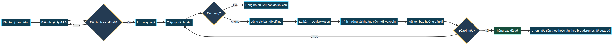

<div align="center">

# ALN

**Know where you are. Know which way to go. Know how to get back.**

[](https://expo.dev/)
[](#)
[](#)
[](#)
[](LICENSE)

**English** · [Tiếng Việt](README.vi.md)

</div>

---

## Overview

ALN is an outdoor wayfinding app for trekking, camping, and journeys where mobile signal may be unavailable. It helps users save important waypoints, calculate bearing and distance with GPS and compass sensors, and continue viewing offline maps without an internet connection.

The app is **not** a replacement for topographic maps, rescue equipment, or survival skills. Its goal is to provide a simple, clear, local-first navigation aid for returning to a chosen point.

```text
Prepare trip → GPS fix → save waypoint → move → offline map + compass
→ bearing / distance → heading arrow → reached / next waypoint
```



---

## How It Helps

| Field Problem | How ALN Helps |
|:--|:--|
| No internet | Uses bundled offline map tiles and local cache |
| Cannot remember the route back | Saves waypoints and breadcrumbs for re-selection |
| Unsure which direction to walk | Calculates bearing, distance, and heading to a waypoint |
| GPS is noisy | Tracks continuously and only saves a marker when accuracy is good enough |
| Phone is tilted | Combines Magnetometer and DeviceMotion to compensate compass tilt |
| Needs a trip review | Stores GPS data locally with SQLite for in-app review |

A typical flow is: wait for GPS to stabilize, save the start point/campsite/water source/turning point as a waypoint, then navigate using the bundled map and compass when connectivity disappears.

---

## Features

- **Waypoint navigation** — GPS status, accuracy, current heading, target bearing, distance, and off-course warnings
- **Accurate waypoint saving** — waits briefly for a stable position before allowing the user to save a named marker with notes and photos
- **Offline maps** — bundled Vietnam tile set for major zoom levels, with satellite and street layers; higher zoom levels can use local cache when available
- **Trip time and sun data** — UTC time, local time, and sunrise/sunset information for planning daylight
- **Local storage** — waypoints, breadcrumbs, and GPS records are stored on-device with SQLite
- **Multilingual UI** — includes English, Vietnamese, and additional localized strings in the app
- **Android-first Expo workflow** — designed for native development builds and release APKs

---

## Tech Stack

| Layer | Used |
|:--|:--|
| Framework | Expo SDK 54 |
| Runtime | React Native 0.81.5, React 19.1 |
| Location | `expo-location` |
| Sensors | `expo-sensors` — Magnetometer and DeviceMotion |
| Local database | `expo-sqlite` |
| Files and tiles | `expo-file-system` |
| Graphics | `react-native-svg` |
| Map rendering | Custom SVG-based offline map renderer |
| Target platform | Android-first, Expo native workflow |

---

## Requirements

- **Node.js 20+**
- **JDK 17** and **Android SDK** for native Android builds
- An Android device or emulator
- Optional: **Expo / EAS** account for cloud builds and releases
- For accurate GPS, compass, and offline-map testing, use a real Android device

> Expo Go is suitable for quick UI/logic checks, but native sensor, location, and offline-map behavior should be tested with a development build or APK on a real device.

---

## Getting Started

```bash
git clone https://github.com/Namtran592005/ALN.git
cd ALN

npm install
npx expo start
```

Run on a native Android device or emulator:

```bash
npx expo run:android
```

Build a release variant locally:

```bash
npx expo prebuild --platform android
npx expo run:android --variant release
```

Generated native folders and build artifacts are intentionally git-ignored. APK/AAB files should be published through a separate release channel such as GitHub Releases.

---

## Project Structure

```text
.
├── App.js                        # Main logic, screens, and styles
├── app.json                      # Expo metadata and native permissions
├── index.js                      # Entry point
├── metro.config.js               # Metro asset configuration for tile images
├── eas.json                      # EAS build profiles
├── assets/
│   ├── icon.png
│   ├── splash-icon.png
│   ├── beep.mp3
│   └── tiles/                    # Bundled offline map tiles
├── docs/
│   ├── aln-workflow.mmd     # Workflow diagram source
│   └── aln-workflow.png     # Workflow diagram used in README
├── package.json
├── LICENSE
├── README.md                     # English (default)
└── README.vi.md                  # Vietnamese
```

---

## Permissions and Privacy

ALN requires location access because GPS is central to navigation. The app also requests camera, media, and storage permissions for capturing and saving waypoint photos.

GPS positions, waypoints, breadcrumbs, and trip data are stored locally on the device to support offline use. Review Android permissions before using the app.

Accuracy caveats:

- GPS accuracy depends on the device, sky visibility, environment, and signal quality.
- Compasses can be affected by metal, magnets, speakers, and nearby electronics.
- If heading becomes unstable, move away from interference and recalibrate the sensor with a figure-eight motion.
- Do not rely on this app alone for dangerous trips. Carry a backup map, spare battery, light, water, communication device, and share your itinerary before starting.

---

## Stable Release

| Field | Value |
|:--|:--|
| App version | `1.0.0` |
| Android version code | `1` |
| iOS build number | `1` |
| Expo SDK | `54` |

---

## Contributing

Issues and pull requests are welcome. When reporting a bug, include the device model, Android version, network status, GPS accuracy, and whether the issue occurs in offline-map mode.

---

## License

The source code is licensed under the [MIT License](LICENSE).

Copyright © 2026 [@Namtran592005](https://github.com/Namtran592005).

The MIT license applies to the source code only. Bundled map tiles, satellite imagery, street-tile data, icons, photos, and other third-party assets remain subject to their own upstream terms. If you redistribute the app with map tiles, review and preserve the relevant source and attribution requirements.

---

## References

- [Expo Documentation](https://docs.expo.dev/) — official Expo documentation
- [React Native Documentation](https://reactnative.dev/docs/getting-started) — official React Native documentation
